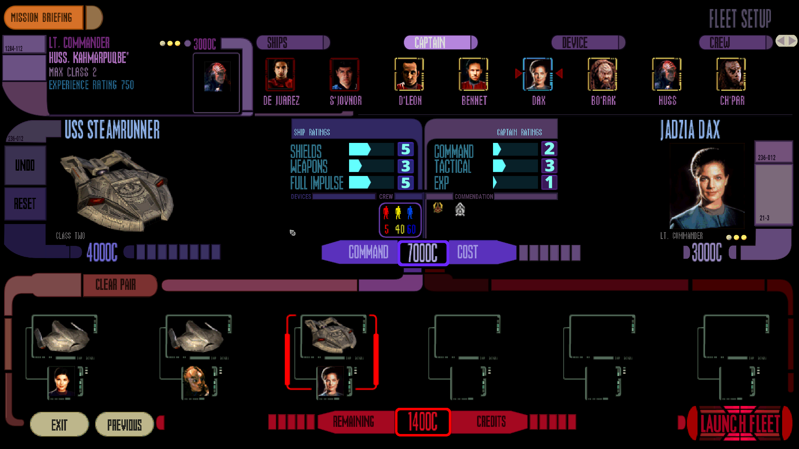

# Dominion Wars Remaster

A faithful fan restoration of *Star Trek: Deep Space Nine – Dominion Wars* (2001),
preserving its original QUANTUM engine, missions, gameplay and Star Trek atmosphere
while improving presentation and addressing technical limitations. This is not a remake.

> **Early Development — Experimental Builds**
>
> This remaster is still in its earliest stages. Many planned improvements are not
> implemented. Builds may contain visual problems, bugs or incomplete features.
> Testing covers very few systems—not universal Windows or GPU compatibility.
> You're welcome to follow development, try an alpha and tell us what works—or doesn't.

## Download and play

[**Download Remastered 1.20 Alpha**](https://github.com/AsusFarstrider/dominion-wars-remaster/releases/tag/v1.20-alpha)
— integration **int-20261117.2**.

Choose **dominion-wars-remastered-1.20-alpha-int-20261117.2.zip** from the release
assets, not GitHub's automatic source archive. Extract it fully, read the separate
**READ-ME-FIRST-1.20-ALPHA.md**, then double-click **Install Dominion Wars Remaster.cmd**.
Keep your original working game and choose a **new destination**. After successful
verification, use the installed desktop shortcut or **Play Dominion Wars Remaster.cmd**.

You need legitimate **North American retail / official 1.04** game data: original
mounted media plus the full official updater, or a supported verified original,
Modernizer or remaster installation. The game and updater are not supplied.
No Git, Python, compiler or encoder is needed by players. See the [1.20 player guide](release/int-20261117.2/READ-ME-FIRST-1.20-ALPHA.md).

The launcher uses your current **primary physical display at desktop origin (0,0)**,
without changing its mode. One size is selected per launch; no live resizing,
resolution switching or monitor hotplug. Actual **1920×1080 and 2560×1440** were
tested on one Windows 11 / AMD RX 6800 XT computer. The exact 1.20 candidate had
a 1080p menu smoke and separate 1440p checks. Other modes, aspect ratios, 4K,
high DPI and other GPUs remain unverified.

The separate [Dominion Wars Modernizer](https://github.com/AsusFarstrider/dominion-wars-modern)
focuses on installing and running the original game. Its accomplishments and tests
are not automatically remaster results.

## Current progress

| Area | Status in 1.20 Alpha |
|---|---|
| Resolution/interface | Adaptive current-primary output with native UI/HUD assembly; original-density HUD art and fonts retained |
| Opening/Main visuals | Restored cards, three opening movies, Main background and six button banks |
| Campaign UI | Updated faction selection and cursor, widescreen Federation Briefing and Fleet Setup, larger Captain roster, and improved Results and gameplay labels |
| Gameplay/input | Reached gameplay; Results → Exit worked from a late autosave at 1440p. Separate 1080p menu smoke exited normally |
| Installation | Separate-copy installer, verified originals, repair/removal/recovery; original-media evidence inherited from the unchanged foundation |
| Ship art/models/portraits | Not restored in this release; specialist experiments are not automatically included |
| Full restoration | In development; no complete restored campaign or universal compatibility claim |

These are bounded checks on one system. Multiplayer remains **unsupported**.
See [1.20 test coverage and limitations](release/int-20261117.2/READ-ME-FIRST-1.20-ALPHA.md#test-coverage-and-known-limitation).

The earlier [1.15 Alpha](https://github.com/AsusFarstrider/dominion-wars-remaster/releases/tag/v1.15-alpha),
fixed-1440p [1.10 Alpha](https://github.com/AsusFarstrider/dominion-wars-remaster/releases/tag/v1.10-alpha),
and [first original-assets experiment](https://github.com/AsusFarstrider/dominion-wars-remaster/releases/tag/int-20261018.1)
remain unchanged. The Esc → Main Menu bug documented for 1.10 is repaired in 1.15.
Keep different builds in separate folders; do not mix their EXEs, wrappers or launchers.

## Help us test

You don't need programming skills. Playing on another computer and reporting
successes is useful too. Include the build/version, Windows, CPU/GPU/driver,
physical resolution, monitor layout/DPI, disc edition and exact steps/results.
Screenshots and logs help; review personal paths and device identifiers before
sharing. Never upload original game files.
Use [Issues](https://github.com/AsusFarstrider/dominion-wars-remaster/issues/new/choose)
and the [testing guide](docs/TESTING.md).

## Help Restore the Artwork

The new artwork is **work in progress, not final**. Every asset is open to
improvement, including art we've already restored. **One asset is a complete
contribution.** You don't have to own an entire screen or ship, learn the game's
file formats, or commit to more work. Maintainers handle conversion and in-game
testing.

To get started, [open an issue](https://github.com/AsusFarstrider/dominion-wars-remaster/issues/new/choose)
with the screen, texture, portrait, model, or other asset you want to improve.
An in-game screenshot or a mockup helps. Please don't upload extracted original
game assets. Share only work you made or have permission to share. Starter briefs
will link to the exact reference, output format, and quality example when ready.

## 1.20 Alpha development screenshots

*Fleet Setup — Captain tab. Artwork is provisional.*

- [Federation briefing — Errands of Mercy](docs/screenshots/1.20/federation-briefing.png)
- [Main menu — Remastered 1.20](docs/screenshots/1.20/main-menu.png)
- [Mission HUD — selected Sabre and Alpha Strike tooltip](docs/screenshots/1.20/mission-hud.png)
- [New Game: faction selection — updated map, artwork in progress](docs/screenshots/1.20/faction-selection-int-20261117.2.png)

- [Mission Results — successful Federation mission](docs/screenshots/1.20/mission-results.png)

These are development captures: faction selection and Results are from
int-20261117.2; the other four are from int-20261117.1. Separately, the player
reported that Exit worked after reaching Results from a late autosave at 1440p.
This is not a full mission, campaign, or hardware compatibility pass.

The exact 1.20 candidate also passed a separate 1080p menu smoke. One active
gameplay Alt-Tab caused a crash; pause before switching away as a precaution,
not a verified fix. Changing display modes while the game runs is unsupported
and caused a hang in a separate test. Quit before changing resolution.

## Direction and technical documentation

Preserve the original experience: missions, mechanics, balance, recognizable UI,
artistic direction and satisfactory original artwork. Improve selected textures,
geometry, effects, compatibility and modest quality-of-life issues where useful.

Our first major milestone remains a **complete, faithfully restored first Federation
mission**, including associated menus, interface, ships, environment and required
assets. It has not been achieved; there is no promised completion date.

See [roadmap](docs/ROADMAP.md), [release notes](docs/RELEASE-NOTES.md),
[integration architecture](integration/docs/ARCHITECTURE.md),
[build procedure](integration/docs/NATIVE-BUILD.md) and
[public-source provenance](docs/PUBLIC-SOURCE.md). Research notes describe experiments,
not necessarily the public download.

## Credits and legal information

Unofficial fan restoration, not affiliated with or endorsed by the original game's
developers, publishers or Star Trek rights holders. Original rights remain with
their respective owners. No complete original game EXE/archive, original soundtrack,
decoder, official updater, disc image or DRM bypass is supplied. Original movie audio
is reconstructed locally from verified owner files; authorized replacement visuals
are included.

MIT covers only newly project-authored code/docs—not original game material,
trademarks, all artwork or third-party components. Restored visuals have the
creator's permission for project distribution; third-party licenses are retained.
See [credits](docs/CREDITS.md), [license scope](docs/LICENSING.md) and
[publication audit](docs/PUBLICATION-AUDIT.md).
